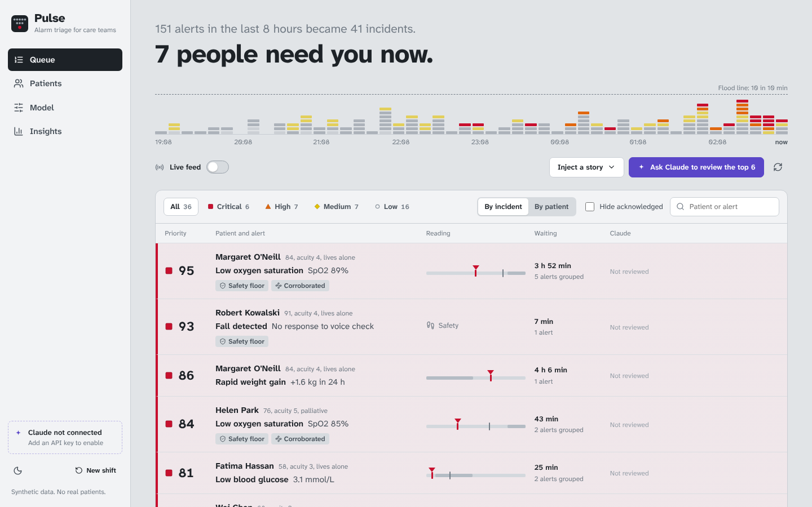
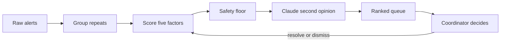
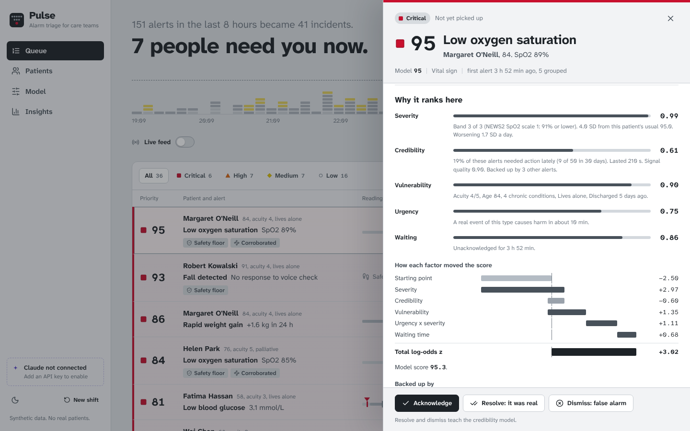
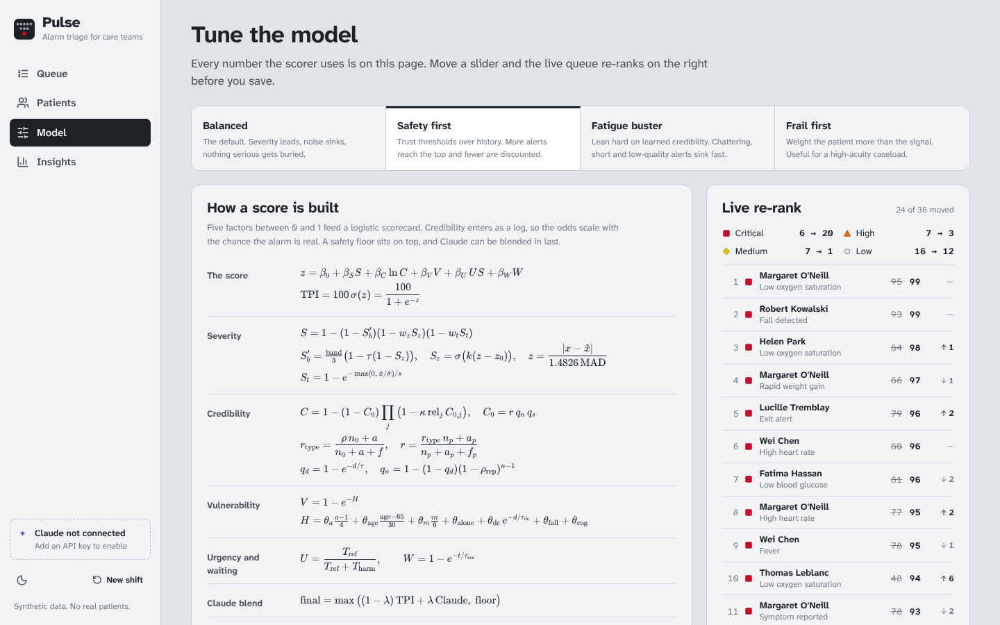

# Pulse

**Alarm triage for care teams.** Pulse takes a pile of noisy alerts from a home and community care caseload and ranks what a human should look at first. A transparent scoring model does the ranking, Claude adds a second opinion on top, and the coordinator makes the call. Every call they make teaches the model.



Built with Django, Django REST Framework, PostgreSQL (SQLite on a laptop), React and the Claude API. Every patient, reading and alert in this repo is synthetic.

Pulse stands for **P**rioritized **U**rgency from **L**ogged **S**ignals and **E**vents.

---

## Why this exists

Alarm fatigue is a well documented patient safety problem. In hospitals, research suggests that 80% to 99% of alarms are false ([Bach et al., BMJ Open Quality, 2018](https://bmjopenquality.bmj.com/content/7/3/e000202)). When most alarms mean nothing, people stop trusting all of them, including the one that matters.

Home and community care has its own version. One coordination desk watches dozens of people at home through remote monitoring devices, fall pendants, smart pill dispensers, visit check-ins and phone calls from family. Finger probes slip during sleep, batteries die, a PSW is twenty minutes late because of traffic on the 401. The real problem (a heart failure patient quietly filling with fluid, an unanswered fall pendant) arrives in the same feed as forty battery warnings.

Industrial control rooms solved a similar problem years ago. The ISA-18.2 alarm management standard defines what an alarm flood is (more than 10 alarms in 10 minutes for one operator), what a stale alarm is, and why the noisiest few sources deserve the most attention. ISA-101 says an operator screen should be grey when things are normal and use colour only for what is abnormal. Pulse brings both ideas to a care desk.

## What it does

| Step | What happens |
| --- | --- |
| 1. Group | Repeats of the same alert for the same patient join one incident. 150 raw alerts become about 39 things to look at. |
| 2. Score | A logistic scorecard combines five factors (severity, credibility, vulnerability, urgency, waiting) into a 0 to 100 priority. Every number is explained on screen. |
| 3. Protect | A safety floor keeps any top-band vital sign or emergency event high, whatever the other factors say. |
| 4. Second opinion | Claude reads the incident, the patient's care plan and the model's evidence, then agrees, escalates or de-escalates and names the next step. |
| 5. Decide | The coordinator acknowledges, resolves (it was real) or dismisses (false alarm). Resolve and dismiss update the credibility model. |



### The pages

| Page | What it is for |
| --- | --- |
| **Queue** | The ranked list. The headline says how many people need you now. The strip under it shows every raw alert of the shift: grey for noise, colour only for what needs a human. Live feed, scenario injection and Claude review live here. |
| **Incident drawer** | Opens from any row. The reading on an analog range bar, Claude's read, a waterfall of how each factor moved the score, the full math with this incident's numbers, a 7-day trend against the patient's own baseline, the care plan, raw alerts and an audit trail. |
| **Patients** | The caseload sorted by most urgent open alert, with each person's vulnerability score. |
| **Model** | Every tunable factor as a slider, four presets, the alert catalog, and a live re-rank of the real queue before you save. |
| **Insights** | Alarm health in ISA-18.2 terms: floods, chattering, stale incidents, bad actors, false alarm rate, what the model has learned, and where Claude disagreed with the model. |



---

## How a score is built

Every active incident gets five factors between 0 and 1. A logistic scorecard turns them into the Triage Priority Index (TPI):

$$
z = \beta_0 + \beta_S S + \beta_C \ln C + \beta_V V + \beta_U \, U S + \beta_W W
$$

$$
\text{TPI} = 100 \cdot \sigma(z) = \frac{100}{1 + e^{-z}}
$$

Each term is a contribution in log-odds, which is why the drawer can show them as a waterfall that adds up to the final score.

Credibility enters as a log on purpose. In odds terms the score is proportional to $C^{\beta_C}$, so an alert half as likely to be real loses the same ground however severe it looks. That is the expected-harm idea (chance it is real times how bad it would be) written so every factor stays explainable. Urgency enters multiplied by severity, the ISA-18.2 idea that priority comes from consequence and time to respond together.

### Severity: how abnormal is it?

For vital signs, three pieces of evidence combine with a noisy-OR, so any one of them can raise severity:

$$
S = 1 - (1 - S_b')(1 - w_z S_z)(1 - w_t S_t)
$$

* **Population band** $S_b = \text{band}/3$. Bands come from [NEWS2](https://www.rcp.ac.uk/resources/national-early-warning-score-news-2/) (Royal College of Physicians, 2017) for SpO2, pulse, systolic BP, temperature and respiration, and from common home-monitoring rules for glucose (Diabetes Canada's under 4.0 mmol/L hypoglycemia threshold), heart-failure weight gain and very high blood pressure. Patients with a prescribed SpO2 target of 88 to 92% are scored on NEWS2 scale 2, so 89% is on target for Arjun Mehta and an emergency for Margaret O'Neill.
* **Personal deviation** $z = |x - \tilde{x}| / \hat{\sigma}$ against the patient's own 14-day baseline, using the median and $\hat\sigma = 1.4826 \cdot \text{MAD}$ so one bad reading can't drag the baseline. $S_z = \sigma(k(z - z_0))$.
* **Personal baseline trust** discounts a band that is normal for this person: $S_b' = S_b \big(1 - \tau(1 - S_z)\big)$.
* **Trend** $S_t = 1 - e^{-\max(0, \dot{x}/\hat\sigma)/s}$, from a least-squares slope over 48 hours, counted only in the worsening direction.

For events (falls, exit alerts, missed doses, family calls) severity starts from the catalog value, then payload modifiers apply (no answer to the pendant's voice check, a time-critical medication) and a transparent red-flag phrase screen reads free text ("slurred", "chest pain", "short of breath").

### Credibility: how likely is it real and actionable?

A hierarchical Beta-Bernoulli model learns from 30 days of resolve and dismiss decisions:

$$
r_{\text{type}} = \frac{\rho \, n_0 + a}{n_0 + a + f} \qquad r = \frac{r_{\text{type}} \, n_p + a_p}{n_p + a_p + f_p}
$$

$\rho$ is the alert type's prior actionable rate, $n_0$ its prior strength, $a$ and $f$ the actionable and false outcomes. The second step shrinks one patient's own history toward the type rate (partial pooling), so Arjun's chattering oximeter stops counting as much as everyone else's.

Then signal plausibility and corroboration:

$$
q_d = 1 - e^{-d/\tau} \qquad q_n = 1 - (1 - q_d)(1 - \rho_{\text{rep}})^{n-1} \qquad C_0 = r \cdot q_n \cdot q_s
$$

$$
C = 1 - (1 - C_0) \prod_j \big(1 - \kappa \, \text{rel}_j \, C_{0,j}\big)
$$

Short blips look like motion artifact ($q_d$), repeats add persistence ($q_n$), device signal quality scales it ($q_s$), and other open alerts on the same patient back each other up. Alerts on the same body system count fully, different systems count half, device alerts never corroborate anything.

### Vulnerability: how fragile is this patient?

$$
V = 1 - e^{-H}, \qquad H = \theta_a \tfrac{a-1}{4} + \theta_{\text{age}} \tfrac{\text{age} - 65}{30} + \theta_m \tfrac{m}{6} + \theta_{\text{alone}} + \theta_{\text{dc}} \, e^{-d/\tau_{\text{dc}}} + \theta_{\text{fall}} + \theta_{\text{cog}}
$$

Acuity, age past 65, number of chronic conditions, living alone, a recent hospital discharge (fading over two weeks), fall history and cognitive impairment. The saturating form keeps $V$ below 1 however many risks stack up.

### Urgency and waiting

$$
U = \frac{T_{\text{ref}}}{T_{\text{ref}} + T_{\text{harm}}} \qquad W = 1 - e^{-t/\tau_{\text{esc}}}
$$

$T_{\text{harm}}$ is the catalog's typical minutes before a real event of that type causes harm (10 for a fall, 15 for low glucose, 720 for weight gain). $W$ grows while an alert sits unacknowledged so nothing rots at the bottom of the queue.

### Safety rules on top of the math

* **Safety floor.** A top-band vital sign with a plausible signal (good quality, not a blip), a fall with no answer, or a red-flag phrase like "slurred" can never score below the floor (75 by default).
* **Claude blend.** $\text{final} = (1 - \lambda)\,\text{TPI} + \lambda\,\text{Claude}$, with $\lambda = 0.3$ by default.
* **Escalation is the safe direction.** If Claude calls something critical with medium or high confidence, it jumps to the critical tier.
* **Claude can't bury an alert.** The floor is re-applied after blending.

### Tiers

Critical from 80, high from 60, medium from 35, low below. Each tier has a shape as well as a colour (square, triangle, diamond, circle), so it reads without colour vision. A filled shape means nobody has picked it up; an outline means someone has.

---

## Tuning the model



The Model page has a control for every factor (35 sliders and 3 switches), grouped into score weights, severity, credibility, urgency, vulnerability, tiers and safety, and Claude. Change anything and the right-hand panel re-ranks the live queue before you save. The same settings are editable in the Django admin.

Four presets show the trade-offs:

| Preset | What it does | What you'll see |
| --- | --- | --- |
| Balanced | The defaults. | About 6 critical, 7 high. |
| Safety first | Trusts thresholds over history, weakens credibility. | Critical jumps from about 6 to about 20. That is the alarm fatigue trap, and the reason the other presets exist. |
| Fatigue buster | Leans on learned credibility, treats short blips as artifact. | Chattering and low-quality alerts sink fast. |
| Frail first | Weights the patient more than the signal. | Lives-alone and recently discharged patients rise. |

The alert catalog at the bottom sets each type's starting beliefs (base severity, time to harm, prior actionable rate) and shows the learned rate next to it.

---

## How Claude is used

Order matters. The math ranks everything first, so the queue works with no network and no API key. Claude is a second reader, not the ranker.

For one incident Claude receives the alert and its raw readings, the patient's conditions, medications, living situation, goals of care and care-plan notes, other open alerts on the same patient, and the model's full evidence (factors, log-odds contributions, learned false alarm rates, safety floor status). The drawer's "See exactly what Claude saw" link shows the prompt, word for word.

It answers through [structured outputs](https://platform.claude.com/docs/en/build-with-claude/structured-outputs) with a JSON schema, so every answer has the same fields: priority, score, agree or escalate or de-escalate, a one-line headline, rationale, the next step, who should act, how soon, confidence, whether it looks like a false alarm, and what missing information would change the call.

The system prompt tells Claude to support a human decision rather than diagnose, to name 911 or the agency's emergency protocol for emergencies, to route palliative patients to the palliative team, and never to set a floored alert below high.

**Model and cost.** The default is `claude-sonnet-5-5` with effort set to `low`, which keeps each judgement to a few seconds. One judgement is a prompt of roughly 1,500 tokens and a short answer, so expect around a cent or two each on Sonnet 5.5. Set `PULSE_CLAUDE_MODEL=claude-haiku-5-5` for cheaper and faster. "Ask Claude to review the top 6" runs six judgements in parallel.

**Without a key** everything works except second opinions. The app tells you how to connect Claude.

---

## Run it on your laptop

You need **Python 3.10 to 3.13** and **Node.js 20 or newer**. The setup script builds the React app into `frontend/dist`, which Django then serves.

### Quick start

macOS or Linux:

```bash
git clone https://github.com/AshraySikka/pulse-alarm-triage.git
cd pulse-alarm-triage
bash scripts/setup.sh      # venv, packages, .env, database, demo data, front end build
bash scripts/start.sh      # serves everything on http://localhost:8000
```

Windows (Command Prompt or PowerShell):

```bat
git clone https://github.com/AshraySikka/pulse-alarm-triage.git
cd pulse-alarm-triage
scripts\setup.bat
scripts\start.bat
```

Open **http://localhost:8000**. Run `start` with `--fresh` (for example `bash scripts/start.sh --fresh`) to generate a new shift that ends right now.

### The same steps by hand

```bash
cd backend
python3 -m venv .venv
source .venv/bin/activate            # Windows: .venv\Scripts\activate
pip install -r requirements.txt
cp .env.example .env                 # Windows: copy .env.example .env
python manage.py migrate
python manage.py seed_demo

cd ../frontend
npm install
npm run build

cd ../backend
python manage.py runserver
```

### Dev mode with hot reload

Two terminals. Django serves the API on port 8000, Vite serves the React app on port 5173 and forwards `/api` to Django.

```bash
# terminal 1
cd backend && source .venv/bin/activate && python manage.py runserver

# terminal 2
cd frontend && npm run dev
```

Open **http://localhost:5173**.

### Turn on Claude

1. Create an API key in the Claude Console at [platform.claude.com](https://platform.claude.com) under API keys.
2. Open `backend/.env` and set `ANTHROPIC_API_KEY=` to your key.
3. Restart the server (Ctrl+C, then start it again).

The sidebar switches to "Claude connected". Values in `backend/.env` win over anything set in your shell, and the app reads `PULSE_CLAUDE_MODEL` and `PULSE_CLAUDE_EFFORT` rather than generic names, so other tools on your machine can't change its behaviour by accident.

### Django admin

```bash
cd backend && source .venv/bin/activate
python manage.py createsuperuser
```

Then open http://localhost:8000/admin for patients, alert types, incidents, raw alerts and the model settings form.

---

## Deploy it

The hosted version splits into three free services:

| Piece | Service | What it holds |
| --- | --- | --- |
| Database | [Neon](https://neon.com) | PostgreSQL. Set `DATABASE_URL` and Django uses it instead of SQLite. |
| API | [Render](https://render.com) | Django behind gunicorn. `render.yaml` in this repo is the blueprint. |
| Front end | [Vercel](https://vercel.com) | The React app, built from the `frontend` folder. |

1. **Neon.** Create a project and copy its connection string. Pick the region closest to your Render region, because loading a demo shift is about a thousand small queries.
2. **Render.** New, Blueprint, pick this repo. When asked, set `DATABASE_URL` to the Neon string, `ANTHROPIC_API_KEY` to your key (optional, leave it empty to run without Claude) and `PULSE_CORS_ORIGINS` to a placeholder for now. The build runs the migrations and loads the demo shift once.
3. **Vercel.** Import the repo, set **Root Directory** to `frontend`, and add the environment variable `VITE_API_URL` with your Render address (for example `https://pulse-api.onrender.com`, no trailing slash). Deploy.
4. **Close the loop.** Back in Render, set `PULSE_CORS_ORIGINS` to your Vercel address and let it redeploy. The browser is only allowed to call the API from origins on that list.

| Variable | Where | What it does |
| --- | --- | --- |
| `DATABASE_URL` | Render | PostgreSQL connection string. Without it the app uses SQLite. |
| `DJANGO_SECRET_KEY`, `DJANGO_DEBUG` | Render | Set by `render.yaml`. The app refuses to start with debug off and no real secret key. |
| `PULSE_CORS_ORIGINS` | Render | Comma-separated front end addresses allowed to call the API. |
| `ANTHROPIC_API_KEY` | Render | Turns on Claude's second opinions. |
| `PULSE_CLAUDE_HOURLY_LIMIT` | Render | Caps Claude requests per hour across the whole app, so a public link can't run up your bill. `0` means no cap. |
| `PULSE_AUTO_RESEED_HOURS` | Render | Loads a fresh synthetic shift on the next visit once the data is this many hours old. `0` means never. |
| `VITE_API_URL` | Vercel | Where the front end finds the API. Leave it unset locally. |

Things to know about free tiers: Render puts an idle service to sleep after 15 minutes and takes about a minute to wake it, and Neon pauses an idle database and wakes it in a moment. Open the site a minute before you show it. The demo is shared and open to anyone with the link, so press **New shift** before you present.

---

## A five-minute demo

Run `bash scripts/start.sh --fresh` a few minutes before you present, so every timestamp is recent. On a hosted copy, press **New shift** instead. If you're using Claude, press "Ask Claude to review the top 6" once beforehand; judgements are saved, so the demo survives bad Wi-Fi.

1. **The headline.** Read it out: about 150 alerts in eight hours became about 40 incidents, and six or seven people need you now. Point at the strip. Grey is noise. Colour is the short list.
2. **Why the top row is on top.** Open Margaret O'Neill's low oxygen. Show the waterfall, then the corroboration: her weight is up 1.6 kg, her heart rate is up, and her daughter called about breathlessness lying flat. Four moderate signals that agree.
3. **The noise that sank.** Scroll to Arjun Mehta. 60-plus oximeter alarms sit near the bottom because 88 to 92% is his prescribed target (NEWS2 scale 2), the signal quality is poor, and his past alarms were dismissed. A naive "below 92%" rule would have paged the desk every few minutes.
4. **Claude's read.** Open Helen Park, who is palliative, and Samuel Brooks, whose Parkinson's medication is time-critical. Ask Claude on each. Read its answers before the demo; they vary, and you want to talk to what it actually said.
5. **The model learns.** Dismiss one of Thomas Leblanc's oximeter blips. The toast shows the learned false alarm rate moving.
6. **Tuning.** On the Model page, preview Safety first and watch critical go from about 6 to about 20. That's the trap. Discard and preview Fatigue buster instead.
7. **A new story.** Back on the queue, Inject a story, then Stroke signs in a call. The red-flag phrase floors it immediately; ask Claude what to do.
8. **Live feed.** Switch it on. New alerts mostly join incidents that already exist, which is the point.
9. **Insights.** The funnel, the ISA-18.2 health checks, and what 30 days of decisions have taught the model.

---

## API

All endpoints are under `/api/`. The browsable API works in a browser too.

| Method | Path | What it does |
| --- | --- | --- |
| GET | `/queue/` | Ranked active incidents, the shift summary and the timeline strip |
| GET | `/incidents/<id>/` | One incident with the full explanation, readings, raw alerts and audit trail |
| POST | `/incidents/<id>/action/` | `{"action": "acknowledge" \| "resolve" \| "dismiss" \| "reopen", "note": "..."}` |
| POST | `/incidents/<id>/judge/` | Ask Claude about one incident |
| GET | `/incidents/<id>/prompt/` | The exact prompt Claude receives |
| POST | `/claude/review/` | `{"limit": 6}` Ask Claude about the top unreviewed incidents in parallel |
| GET | `/claude/status/` | Whether a key is configured, which model |
| GET, PUT | `/config/` | Model settings, schema and presets |
| POST | `/config/preview/` | Re-rank the queue under draft settings without saving |
| POST | `/config/reset/` | Back to defaults |
| GET, PATCH | `/alert-types/`, `/alert-types/<code>/` | The alert catalog with learned rates |
| GET | `/patients/` | Caseload with vulnerability and open incidents |
| GET | `/stats/` | Insights page data |
| POST | `/simulate/tick/` | Generate a few realistic alerts now |
| GET, POST | `/simulate/scenarios/`, `/simulate/scenario/` | List and inject demo stories |
| POST | `/ingest/` | Send one real alert in, webhook style |
| POST | `/demo/reset/` | Fresh synthetic shift ending now |

Send an alert from another system:

```bash
curl -X POST http://localhost:8000/api/ingest/ \
  -H "Content-Type: application/json" \
  -d '{"patient_id": 1, "alert_type": "SPO2", "value": 88, "signal_quality": 0.9, "duration_s": 120, "source": "Pulse oximeter"}'
```

Alert type codes: `SPO2`, `HR`, `SBP_HIGH`, `SBP_LOW`, `TEMP`, `RR`, `GLUCOSE_LOW`, `GLUCOSE_HIGH`, `WEIGHT`, `FALL`, `PANIC`, `WANDERING`, `INACTIVITY`, `MISSED_VISIT`, `MISSED_MED`, `SYMPTOM`, `O2_EQUIPMENT`, `DEVICE_OFFLINE`, `LOW_BATTERY`.

There is also a terminal stream: `python manage.py simulate_alerts --every 5`.

---

## Project layout

```
pulse-alarm-triage/
├── backend/
│   ├── manage.py
│   ├── requirements.txt
│   ├── build.sh                 Render build step: install, migrate, seed an empty database
│   ├── .env.example
│   ├── pulse/                   Django project settings and URLs
│   └── triage/
│       ├── scoring.py           The math: bands, factors, scorecard, safety rules, tunable parameters
│       ├── engine.py            Pulls baselines, trends and learned outcomes from the database and scores incidents
│       ├── ingest.py            Raw alert in, grouped incident out
│       ├── claude_judge.py      Claude prompt, JSON schema, parallel review, error handling
│       ├── catalog.py           Alert types and their starting beliefs
│       ├── seed.py              The synthetic caseload, shift and 30 days of history
│       ├── simulator.py         Live feed and demo stories
│       ├── views.py, urls.py    REST API
│       ├── admin.py             Django admin, including a form for every model setting
│       └── tests.py             38 tests for the math, the API and the admin
├── frontend/
│   ├── src/
│   │   ├── pages/               Queue, Patients, Model, Insights
│   │   ├── components/          Drawer, score breakdown, range bar, flood strip, Claude card, charts
│   │   ├── lib/                 API client, formatting, hooks
│   │   └── styles/              Tokens and app styles
│   └── dist/                    The built app (created by npm run build, ignored by git)
├── scripts/                     setup and start for macOS, Linux and Windows
├── render.yaml                  Render blueprint for the API
└── docs/screenshots/
```

## Tests

```bash
cd backend && source .venv/bin/activate
python manage.py test triage
```

They cover the NEWS2 bands (including scale 2), monotonicity of every factor, the Beta learning, corroboration, the safety floor, Claude's blend and escalation rules, grouping, the preview endpoint, the ingest webhook, the Claude error paths and the admin settings form.

---

## Before this goes anywhere near real patients

This is a demo, and an honest one should say what it isn't.

* **Synthetic data, illustrative thresholds.** The bands and weights are reasonable starting points, not clinically validated. The scorecard weights are set by hand. The next step would be fitting them to labelled outcomes with logistic regression and checking calibration.
* **No authentication on the API.** Anyone who can reach the server can change settings, reset the demo and use your Claude key, which is why the hosted demo caps Claude requests per hour. Add logins, roles (coordinator and admin) and per-action audit before sharing it beyond a demo.
* **Medical device rules.** Software that prioritizes patient alerts can be regulated as software as a medical device. In Canada that means Health Canada's medical device framework.
* **Privacy.** Real patient data in Ontario falls under PHIPA. Sending it to any external AI service needs a legal basis, an agreement with the provider and de-identification where possible.
* **Not production infrastructure.** The hosted demo runs on free tiers: one small instance, no backups, no monitoring. A real deployment needs redundancy, backups, access controls and an audit log.
* **Claude can be wrong.** That is why it is a blended second opinion with an audit trail, why it can never bury a floored alert, and why a human makes every decision.

## Why I built this

I studied Instrumentation and Control Engineering, where alarm management is a discipline with its own standards. I later spent years in eClinical implementation and healthcare project coordination. Pulse is what those two halves of my work look like together: control-room alarm practice, applied to the coordination desk of a home care team.

## Sources and standards

* Royal College of Physicians. [National Early Warning Score (NEWS) 2](https://www.rcp.ac.uk/resources/national-early-warning-score-news-2/), 2017.
* ANSI/ISA-18.2, Management of Alarm Systems for the Process Industries. Alarm flood and stale alarm definitions as summarized by [IChemE](https://www.icheme.org/media/17392/lc-0151_21-lead-process-safety-metrics-alarm-rationalisation-final.pdf).
* ANSI/ISA-101.01, Human Machine Interfaces for Process Automation Systems (high-performance HMI).
* Bach, Berglund and Turk. Managing alarm systems for quality and safety in the hospital setting. BMJ Open Quality, 2018.
* Diabetes Canada Clinical Practice Guidelines, hypoglycemia defined as plasma glucose under 4.0 mmol/L.
* Anthropic. [Structured outputs](https://platform.claude.com/docs/en/build-with-claude/structured-outputs) and [effort](https://platform.claude.com/docs/en/build-with-claude/effort) documentation.

Typeface: [Atkinson Hyperlegible](https://github.com/googlefonts/atkinson-hyperlegible) by the Braille Institute, chosen because misreading 91 as 97 matters here.
